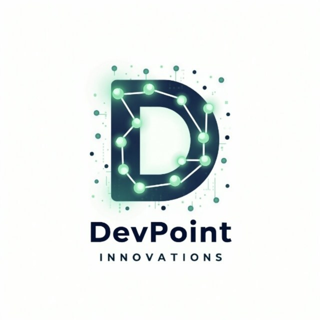

**Software brasileiro, feito por devs, para resolver problema de verdade.** 🇧🇷

- 👋 Olá! Aqui é a **DevPoint Innovations**
- 💡 Gostamos de transformar problemas reais em produto
- ☕ Backend em **Java + Spring Boot**, porque gostamos de coisa sólida
- 📱 Apps em **Expo / React Native** e painéis em **Angular**
- ☁️ Tudo rodando na nuvem do **Google Cloud**

 

  

##

### 🌱 No que estamos trabalhando

**Pulseira Verde**, nosso projeto atual: app mobile, API e painel administrativo, com lançamento público previsto para **março de 2027**.

👉 Conheça mais em [saudemonitor.dev](https://saudemonitor.dev) ou dê uma olhada no código: [app](https://github.com/devpointinnovations/pulseira-verde-mobile) · [API](https://github.com/devpointinnovations/pulseira-verde-backend) · [painel](https://github.com/devpointinnovations/pulseira-verde-admin)

##

Feito com ☕ em Java (e um pouco de TypeScript).

